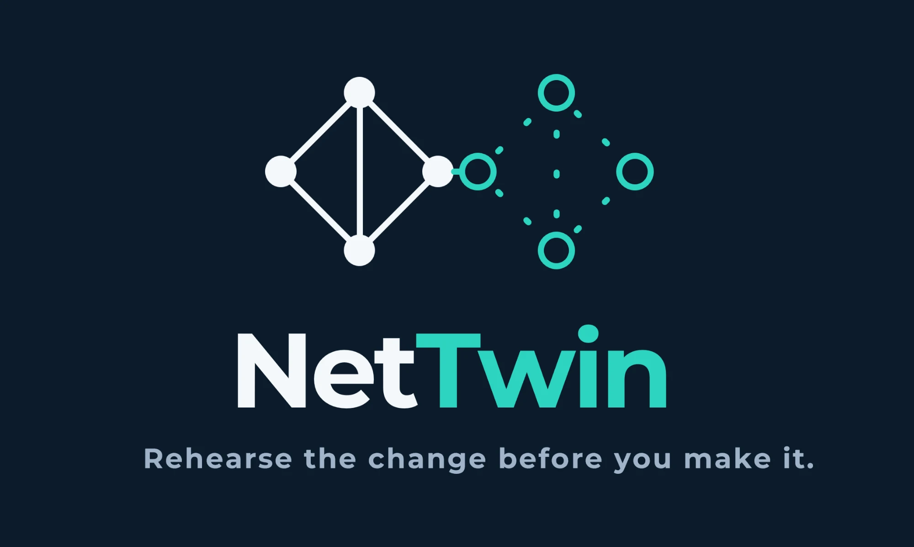

<p align="center"></p>

# NetTwin (network digital twins)

**NetTwin runs a network change, or a failure, on a digital copy of the network before the real one sees it.**
It says whether the change can go ahead, how sure it is, and why.

| Twin | Engine | Example question |
|---|---|---|
| **ip** | ns-3 | "If link L-12 fails, does acme keep its loss under 1%?" |
| **optical** | GNPy | "If fibre A-B is cut, does LP-1 keep 3 dB of margin?" |
| **wifi** | ns-3 802.11 | "If ap-1 fails, does the camera keep its traffic while it roams?" |
| **ntn** | orbits and link budgets | "If it rains on the satellite terminal, does it keep 99% availability?" |

- **A probability, not a guess:** each question runs as an ensemble, with and without the change.
- **A trust tier:** calibrated against measurements (A, B), or not (C, which may reject but never approve).
- **A decision by rule:** propose, reject, gather more data. An AI agent may explain it, not make it.

## Quick start

```bash
git clone https://github.com/maconair0/NetTwin.git netwins && cd netwins
python3 -m venv .venv && .venv/bin/pip install -r requirements.txt
docker build -t netwins-ns3:3.43-r2 engine          # the ns-3 engines (once; optical and ntn need only Python)
.venv/bin/python -m netwins predict examples/optical-cut.json
```

It also runs as an HTTP service (`python -m netwins serve`) and speaks the
[`canah.twin/1`](https://github.com/maconair0/CANAH/blob/main/docs/TWIN_CONTRACT.md) contract.
[CANAH](https://github.com/maconair0/CANAH) uses it as its digital twin.

## Learn more

- [The full guide](docs/GUIDE.md): scenarios for each twin, reading the answer, calibration, mirroring live
  networks, the contract, settings, measured accuracy and limits.
- [`examples/`](examples): a runnable scenario for each twin. [`skills/`](skills): how an agent should use each one.
- Tests: `.venv/bin/python -m unittest discover -s tests -t .`

## Authors and license

[maconair0](https://github.com/maconair0) (owner and author), with Claude (Anthropic) as co-contributor.
MIT: see [LICENSE](LICENSE). ns-3 (GPL-2.0) is built into the engine image only; GNPy is BSD-3-Clause.
