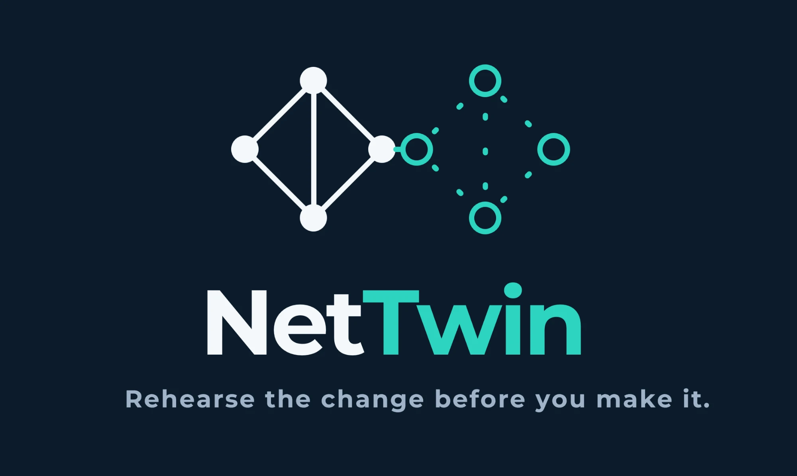

# NetTwin: the full guide

Everything in detail: how it works, every setting and page, the measurements behind the claims. The short version is the [README](../README.md).

<p align="center"></p>

# NetTwin (network digital twins)

**NetTwin runs a network change, or a failure, on a digital copy of the network before the real one sees it.** It then says
whether the change can go ahead, how sure it is, and why.

It has four twins, one per kind of network, behind one pipeline:

| Twin | Engine | Answers questions like |
|---|---|---|
| **ip** | [ns-3](https://www.nsnam.org) (packet-level) | "If link L-12 fails, does acme keep its loss under 1%?" · "Would doubling L-13 make the detour safe?" |
| **optical** | [GNPy](https://github.com/Telecominfraproject/oopt-gnpy) (physical layer) | "If fibre A-B is cut, does lightpath LP-1 keep 3 dB of margin after it restores?" · "Could it run at 400G?" |
| **wifi** | ns-3 802.11ax/ac/n | "If access point ap-1 fails, does the camera keep its loss under 1% while it roams?" |
| **ntn** | orbital geometry and link budgets (Python) | "If 25 mm/h of rain falls on the Turin terminal, does its LEO backhaul keep 99% availability?" · "What if we lose the inter-satellite links?" |

Three things set it apart from running a simulator by hand:

- **It answers with a probability, not a number.** Every question runs as an ensemble: the network with and
  without the change, on the same seeds and the same sampled inputs. The answer is the probability that your
  requirement holds, with its interval, the change's effect, and the figures behind it.
- **It says how far it can be trusted.** The twin learns its own error from measurements (conformal calibration),
  widens or shifts its answers accordingly, and gives every answer a trust tier:
  - **A:** calibrated on measurements;
  - **B:** calibrated, but less so;
  - **C:** not calibrated. An uncalibrated twin may reject a change, but never let one go ahead.
- **Its decision is code, not a model's opinion.** A fixed policy turns the prediction into one of propose, reject,
  gather more data, or met / not met when no change was asked about. An AI agent may explain the decision; it does
  not make it.

NetTwin runs on its own: a command line, a Python API and an HTTP service. It also implements the
[`canah.twin/1` contract](#the-contract-canahtwin1), so any agent that speaks it can use it. [CANAH](https://github.com/maconair0/CANAH),
the controller-agnostic network agent, is the reference agent: it asks NetTwin before it changes a network.

---

## Contents

1. [Quick start](#quick-start)
2. [How a prediction is made](#how-a-prediction-is-made)
3. [Scenarios: the three twins](#scenarios-the-three-twins)
4. [Reading the answer](#reading-the-answer)
5. [Calibration and trust](#calibration-and-trust)
6. [Mirroring a live network, and checking a write before it is sent](#mirroring-a-live-network-and-checking-a-write-before-it-is-sent)
7. [The contract: `canah.twin/1`](#the-contract-canahtwin1)
8. [Using NetTwin from CANAH](#using-netwin-from-canah)
9. [Configuration](#configuration)
10. [How well it does](#how-well-it-does)
11. [Layout](#layout)
12. [Tests](#tests)
13. [Limits](#limits)
14. [Authors and license](#authors-and-license)

---

## Quick start

You need Python 3.10+ and Docker (for the ns-3 engines). The optical twin needs only Python.

```bash
git clone https://github.com/maconair0/NetTwin.git netwins && cd netwins
python3 -m venv .venv && .venv/bin/pip install -r requirements.txt     # pydantic, numpy, requests, pyyaml, GNPy
docker build -t netwins-ns3:3.43-r2 engine                              # ns-3.43 with both engines (~20 min, once)
```

Ask a question from the command line. Each example names its twin in its `"domain"` field:

```bash
.venv/bin/python -m netwins validate examples/acme-L12-failure.json     # is it runnable?
.venv/bin/python -m netwins predict  examples/acme-L12-failure.json     # IP: a link failure
.venv/bin/python -m netwins predict  examples/optical-cut.json          # optical: a fibre cut and restoration
.venv/bin/python -m netwins predict  examples/wifi-ap-failure.json      # Wi-Fi: an access point fails
.venv/bin/python -m netwins predict  examples/ntn-rain-fade.json        # NTN: rain on a LEO terminal
.venv/bin/python -m netwins predict  examples/acme-L12-failure.json --engine fake   # no Docker: a stand-in model, for trying it out
```

From Python:

```python
import json
from netwins.contract import NetwinsTwin

twin = NetwinsTwin(home="netwins_data")                 # engine: docker (default), local:<binary>, or fake
result = twin.predict(json.load(open("examples/optical-cut.json")))
print(result["decision"])       # {'action': 'gather_more_data', 'reasons': [...]}
print(result["probability"])    # {'p': 1.0, 'interval': [0.91, 1.0], 'members': 40}
print(result["trust"])          # {'tier': 'C', 'why': 'margin_db: no calibration data'}
```

As an HTTP service, for an agent or anything else:

```bash
NETWINS_TOKEN=change-me .venv/bin/python -m netwins serve --port 8420
curl -s localhost:8420/twin -H "Authorization: Bearer change-me" | jq '.domains[].domain'
curl -s localhost:8420/twin/predict -H "Authorization: Bearer change-me" \
     -H 'content-type: application/json' -d "{\"scenario\": $(cat examples/optical-cut.json)}" | jq .decision
```

---

## How a prediction is made

```
scenario (JSON) ──► validate ──► ensemble ──────────────► aggregate ──► calibrate ──► decide
                     schema       pairs of runs:            per entity    past errors     the policy:
                     semantics    baseline and changed,     and KPI:      shift and       propose · reject ·
                     ranges       same seed, same sampled   distribution, widen; trust    gather_more_data ·
                                  inputs; adaptive: more    paired effect tier A/B/C      met · not_met
                                  runs only while undecided
```

1. **Validate.** Pydantic checks the shape. Semantic checks look at everything else: references exist, values are
   inside the range the engine was validated for, events fall inside the run, every path a change or an uncertainty
   names is real. A problem comes back as a sentence to fix, not a stack trace.
2. **Ensemble.** Each member is a *pair*: the network without the change (baseline) and with it, on the same random
   seed and the same draw of every uncertain input (common random numbers). Their difference is the change's effect,
   not noise. Runs are added in batches only while the answer is still undecided against the policy's thresholds,
   up to a cap. Each run is a locked-down container: no network, read-only, one CPU, 512 MB.
3. **Aggregate.** For every entity (a demand, a lightpath) and every KPI: the distribution with the change, without
   it, and the paired effect. `p_meets` is the share of members in which every requirement held, with its Wilson
   95% interval.
4. **Calibrate.** The model's past errors for that domain and KPI are added to every member, and the calibrated
   90% interval is centred on the bias the twin has learned. The trust tier comes from how well those intervals have
   covered reality.
5. **Decide.** A fixed table decides (`netwins/policy.py`):

   | Situation | Decision |
   |---|---|
   | no requirement stated | gather_more_data |
   | the snapshot is too old, or a value is outside the validated range | reject |
   | the change is clearly predicted to break a requirement (whatever the trust) | reject |
   | the requirements fail without the change too | gather_more_data (the change is not what breaks them) |
   | trust tier C | gather_more_data (it may reject, never approve) |
   | the probability's interval straddles the threshold at the run cap | gather_more_data |
   | p ≥ 0.99 and its interval too, tier A, an allow-listed change within step limits | auto_apply_eligible (off by default) |
   | p ≥ 0.9 and its interval too, tier A or B | propose (a human approves) |

   When no change was asked about, propose becomes **met** and reject becomes **not_met**.

---

## Scenarios: the four twins

A scenario is JSON: the network, the traffic, the what-if (`change`), what must hold (`requirements`) and what is
not known exactly (`uncertain_params`). `python -m netwins schema --domain <ip|optical|wifi|ntn>` prints the full JSON
Schema, and `examples/` has one runnable scenario per twin.

Paths name fields the same way everywhere: `<kind>.<id>.<field>` (`links.L-12.rate_mbps`) or `<kind>.<field>`
(`radio.path_loss_exponent`). A change's `set` and an uncertainty's `path` use them.

### IP (`"domain": "ip"`)

```json
{"domain": "ip",
 "topology": {"nodes": [{"id": "pe-a"}, {"id": "p-1"}, {"id": "pe-b"}],
              "links": [{"id": "L-1", "a": "pe-a", "z": "p-1", "rate_mbps": 100, "delay_ms": 2, "queue_pkts": 100}]},
 "traffic": {"demands": [{"id": "acme", "src": "pe-a", "dst": "pe-b", "protocol": "udp", "rate_mbps": 30}]},
 "change": {"events": [{"t": 10, "type": "link_down", "target": "L-1"}],
            "set": [{"path": "links.L-2.rate_mbps", "value": 200}],
            "add_demands": [], "remove_demands": []},
 "duration_s": 30,
 "requirements": [{"demand": "acme", "kpi": "loss_ratio", "op": "<", "value": 0.01}],
 "uncertain_params": [{"path": "demands.acme.rate_mbps", "dist": "normal", "mean": 30, "std": 3}]}
```

- **KPIs per demand:** `throughput_mbps`, `delay_ms_mean`, `jitter_ms_mean`, `loss_ratio`.
- **Engine:** ns-3 point-to-point links, a FIFO of `queue_pkts` per link, UDP at a rate or TCP bulk, global routing
  that recomputes on a link event.

### Optical (`"domain": "optical"`)

```json
{"domain": "optical",
 "topology": {"nodes": [{"id": "A"}, {"id": "B"}, {"id": "C"}],
              "links": [{"id": "F-ab", "a": "A", "z": "B", "length_km": 240, "loss_db_per_km": 0.2, "span_km": 80}]},
 "traffic": {"lightpaths": [{"id": "LP-1", "src": "A", "dst": "B", "rate_gbps": 200, "path": ["F-ab"], "restore": true}],
             "demands": [{"id": "acme", "lightpath": "LP-1", "rate_mbps": 40000}]},
 "change": {"events": [{"t": 0, "type": "link_down", "target": "F-ab"}]},
 "requirements": [{"demand": "LP-1", "kpi": "margin_db", "op": ">=", "value": 3}],
 "uncertain_params": [{"path": "links.F-ac.loss_db_per_km", "dist": "normal", "mean": 0.21, "std": 0.01}]}
```

- **KPIs per lightpath:** `gsnr_db`, `osnr_db` (0.1 nm), `margin_db` (over the mode's required OSNR),
  `pre_fec_ber`, `up`, `path_km`, `hops`.
- **KPIs per demand riding a lightpath:** `throughput_mbps`, `loss_ratio`, `delay_ms_mean`.
- **Modes** (GNPy's Voyager transceiver): 100G, 200G, 300G or 400G, needing 12, 16, 18 or 21 dB OSNR.
- **A cut** reroutes a restoring lightpath on the shortest surviving path and downs one that does not restore.
- **Changes** can add or remove lightpaths (`add_lightpaths`, `remove_lightpaths`).
- **Engine:** GNPy designs the line (an amplifier every `span_km`, its power settings) and propagates a full C-band
  load. The packet layer is a fluid model with the FEC cliff: no margin, no traffic.

### Wi-Fi (`"domain": "wifi"`)

```json
{"domain": "wifi",
 "topology": {"aps": [{"id": "ap-1", "x": 0, "y": 0, "channel": 36, "width_mhz": 20, "tx_power_dbm": 20},
                      {"id": "ap-2", "x": 30, "y": 0, "channel": 36}],
              "stations": [{"id": "cam", "x": 8, "y": 3}],
              "radio": {"standard": "ax", "path_loss_exponent": 3.0}},
 "traffic": {"demands": [{"id": "camera", "src": "cam", "dst": "server", "protocol": "udp", "rate_mbps": 8}]},
 "change": {"events": [{"t": 5, "type": "ap_down", "target": "ap-1"}]},
 "duration_s": 12,
 "requirements": [{"demand": "camera", "kpi": "loss_ratio", "op": "<", "value": 0.01}],
 "uncertain_params": [{"path": "radio.path_loss_exponent", "dist": "uniform", "low": 2.8, "high": 3.4}]}
```

- **KPIs per demand:** `throughput_mbps`, `delay_ms_mean`, `jitter_ms_mean`, `loss_ratio`.
- **Topology:** the access points bridge to a wired backbone with a `server`; every demand has `"server"` at one
  end.
- **Association:** a station starts on the access point it hears loudest (log-distance path loss). When that one
  fails, it re-associates with another on the same channel after ns-3's missed-beacon timeout.
- **Changes** can move access points or stations, or change power, channel, width or the path-loss exponent.

### Non-terrestrial (`"domain": "ntn"`)

Satellites (LEO, MEO, GEO) and high-altitude platforms (HAPS) carrying traffic between ground sites, followed
over a window of time (`duration_s`, every `step_s`) while the satellites move.

```json
{"domain": "ntn",
 "topology": {"sites": [{"id": "T-turin", "kind": "terminal", "lat_deg": 45.07, "lon_deg": 7.69, "eirp_dbw": 45, "g_t_dbk": 13},
                        {"id": "GW-fucino", "kind": "gateway", "lat_deg": 42.0, "lon_deg": 13.6, "eirp_dbw": 70, "g_t_dbk": 30}],
              "constellations": [{"id": "LEO", "planes": 24, "per_plane": 22, "altitude_km": 550, "inclination_deg": 53, "isl": true}]},
 "radio": {"uplink_ghz": 30, "downlink_ghz": 20, "bandwidth_mhz": 250},
 "traffic": {"flows": [{"id": "backhaul-1", "src": "T-turin", "dst": "GW-fucino", "rate_mbps": 100}]},
 "change": {"events": [{"t": 0, "type": "rain", "target": "T-turin", "value": 25}]},
 "duration_s": 600, "step_s": 10,
 "requirements": [{"demand": "backhaul-1", "kpi": "availability", "op": ">=", "value": 0.99}]}
```

- **KPIs per flow:** `availability`, `throughput_mbps`, `loss_ratio`, `delay_ms_mean`, `delay_ms_max`,
  `margin_db_min`, `handovers`, `doppler_khz_max`.
- **Each step:**
  1. where every satellite is (circular orbits under a turning Earth; a GEO over its longitude; a HAPS fixed);
  2. which satellites each site sees above its minimum elevation;
  3. the route: up, across inter-satellite links (a +Grid in a Walker constellation) when there are any, down.
     The serving satellite is kept while it can be; a handover interrupts the flow for `handover_ms`;
  4. each hop's link budget (free-space, gaseous and rain loss from ITU-R P.838/P.618, simplified; pointing
     loss; G/T), the DVB-S2X MODCOD it allows, and its capacity, shared by the flows on a satellite.
- **Changes:** rain on a site (`rain`, mm/h), a satellite or a gateway lost, inter-satellite links cut
  (`isl_down`, one satellite or `all`), more flows, or any settable value (`radio.bandwidth_mhz`,
  `sites.<id>.g_t_dbk`, a constellation's EIRP ...).
- **Measured on the example:** clear sky gives 99.97% availability and 11.4 ms. 25 mm/h of rain on the terminal's
  30 GHz uplink gives 66.6% availability, and the twin rejects it. A GEO path takes more than 240 ms.

---

## Reading the answer

`predict` returns the contract's Result (`netwins.contract.to_result`). The richer internal envelope is kept under
`NETWINS_HOME/runs/<run_id>.json`.

```json
{"ok": true,
 "decision": {"action": "reject", "reasons": ["p=0.000 (95% interval 0.000-0.083) is below 0.9 (trust tier B)"]},
 "probability": {"p": 0.0, "interval": [0.0, 0.083], "members": 40},
 "baseline_probability": {"p": 1.0, "interval": [0.912, 1.0], "members": 40},
 "trust": {"tier": "B", "why": "loss_ratio: calibrated on synthetic data only (never tier A)"},
 "figures": [{"entity": "acme", "kpi": "loss_ratio",
              "changed": {"mean": 0.155, "p5": 0.149, "p50": 0.155, "p95": 0.161},
              "baseline": {"mean": 0.0004, "p5": 0.0003, "p50": 0.0004, "p95": 0.0005},
              "effect": {"mean": 0.154, "p5": 0.148, "p50": 0.154, "p95": 0.160},
              "calibrated_90": [0.149, 0.161]}],
 "change_ran": {"events": [{"t": 10, "type": "link_down", "target": "L-12"}]},
 "not_modelled": "Protocols and traffic are modelled, not router software; ...",
 "fidelity": "packet-level (ns-3 point-to-point, global routing)"}
```

| Field | Meaning |
|---|---|
| `decision` | what the policy decided, with every rule that fired |
| `probability` | the probability that every requirement holds with the change: model error included, interval, how many runs |
| `baseline_probability` | the same without the change. When both are low, the change is not the problem |
| `trust` | the weakest tier among the KPIs the requirements use, and why |
| `figures` | per requirement: the distribution with the change, without it, the paired effect, the calibrated range |
| `change_ran` | exactly what was simulated: report this, and nothing the scenario did not contain |
| `not_modelled` | what this twin leaves out: say it with the answer |

---

## Calibration and trust

A twin is a model, and models are wrong in consistent ways. NetTwin keeps, per domain and KPI, the error between
what it predicted and what was then measured (`NETWINS_HOME/calibration.sqlite`). Every later prediction uses that
record in three ways:

- **The model error enters the probability.** Past residuals are added to every ensemble member, so `p` accounts
  for the twin being wrong, not only for random variation.
- **The interval is conformal.** The calibrated 90% range is centred on the bias the twin has learned, so a model
  that is consistently low is moved, not merely widened. Its width is the conformal quantile of past errors, which
  gives a finite-sample coverage guarantee when errors are exchangeable.
- **The tier is earned.** Leave-one-out, how often would the interval have held the measurement?

| Tier | Needs |
|---|---|
| **A** | ≥ 30 points, ≥ 85% coverage, recent, not synthetic only |
| **B** | ≥ 10 points, ≥ 80% coverage (synthetic truth alone can reach B, never A) |
| **C** | anything less: the twin may reject a change, never let one go ahead |

Three sources of truth are supported:

```bash
# Synthetic (IP): the twin against hidden perturbations of itself. Useful before any testbed exists;
# labelled as synthetic, so it can never reach tier A.
.venv/bin/python -m netwins calibrate-synthetic --n 30

# A lab's physics (optical): GNPy against a physical-layer simulator's kept runs, each line rebuilt from
# its measured launch powers and amplifier noise figures. Labelled "lab".
NETWINS_LAB_OPTICAL=/path/to/physical_layer/data .venv/bin/python -m netwins calibrate-optical-lab
```

Measurements from your testbed, from Python:

```python
from netwins.calibration import Calibration
cal = Calibration("netwins_data/calibration.sqlite")
cal.add("ip", "loss_ratio", predicted={"p5": 0.010, "p50": 0.012, "p95": 0.015}, measured=0.014, source="testbed")
print(cal.status("ip", "loss_ratio"))   # n, coverage, bias, conformal q90, tier, why
```

`python -m netwins status` shows the calibration of every twin's KPIs.

---

## Mirroring a live network, and checking a write before it is sent

For packet networks NetTwin can build its picture of the network from the controllers themselves, and judge a
controller write before it is sent. It reads controllers through an
[agentic MCP](https://github.com/maconair0/agentic-mcp) (`AGENTIC_MCP_URL`, `AGENTIC_MCP_TOKEN`). That service seats
each controller (ONOS, Ryu, …) behind one contract of verbs: read devices, read links, read services, read
statistics, provision, tear down, adjust, configure a device.

**Mirroring (`netwins/mirror.py`).** NetTwin reads devices, links, hosts and services through each controller's own
tools, as the agentic MCP maps them, and reads the traffic counters twice, a few seconds apart.
- **What goes in the snapshot:** the topology, link capacities, services as demands, and the traffic the counters
  show beyond the services, as background load.
- **Packet controllers only:** the mirror builds the IP twin's picture. It refuses an optical controller, whose
  fibres and lightpaths belong in an optical scenario instead, and it keeps no snapshot when a controller returns
  no devices and no links. Such an empty snapshot used to be filed as an IP network and hid the real ones.
- **Every value is marked** measured or assumed.
- **Assumptions cap the trust:** if fewer than half the link capacities came from the controller, predictions on
  that snapshot are capped at tier C.
- **Shapes:** it reads ONOS-, Ryu- and emulator-shaped answers, and treats `1`, `"0000000000000001"` and
  `"of:0000000000000001"` as one switch.

**Checking a write (`netwins/changes.py`, `netwins/gate.py`).** A proposed write (controller, tool, arguments) is
translated by its contract verb into a twin change, on a fresh mirror:

| Verb | Becomes |
|---|---|
| provision | a new demand at its rate |
| teardown | the service's demand removed |
| adjust | the service's new rate |
| configure_device | a port shut down (its link fails), or a port speed (its link's rate) |
| reroute | not modelled |

The prediction then decides. Anything the write leaves out (no rate, an end the twin cannot find) comes back as a
question for the operator, never a guess.

```python
twin = NetwinsTwin()
twin.check_write("onos", "provision", {"name": "web1", "from": "pe-a", "to": "dc-1", "bandwidth_mbps": 10}, {})
# {'action': 'propose', 'send_as': 'onos__add_flow with exactly these arguments: ...', 'result': {...}, ...}
```

An agent's write gate (CANAH's, for instance) holds the write unless the check says propose, or an operator
overrides it.

---

## The contract: `canah.twin/1`

NetTwin answers one contract, the same in-process (`netwins.contract:twin`) and over HTTP (`python -m netwins serve`):

| Call | HTTP | Returns |
|---|---|---|
| describe | `GET /twin` | its three twins: what each answers, KPIs, an example, fidelity, what is not modelled; capabilities |
| validate | `POST /twin/validate` `{"scenario"}` | `{"ok", "problems"}` |
| predict | `POST /twin/predict` `{"scenario"}` | the Result above |
| check_write | `POST /twin/check_write` `{"controller", "tool", "arguments", "answers"}` | the check: action, reasons, questions, next, send_as, the prediction behind it |
| extra | `POST /twin/extra` `{"name", "arguments"}` | `snapshots`, `inspect`, `subnetwork` (a slice of a network with every demand that crosses it), `mirror` |

The contract is defined, and enforced, by [CANAH](https://github.com/maconair0/CANAH/blob/main/docs/TWIN_CONTRACT.md).
Any agent can use NetTwin through it, and any other twin that implements it can stand in for NetTwin.

The HTTP service uses only the standard library. Set `NETWINS_TOKEN` to require a bearer token; it warns when it
listens beyond localhost without one.

---

## Using NetTwin from CANAH

Put NetTwin where CANAH can import it, and add it to CANAH's `canah.yaml`:

```yaml
twins:
  - {name: netwins, kind: python, spec: "netwins.contract:twin", path: "~/netwins"}
twin_active: netwins
```

Install NetTwin's requirements in CANAH's environment too (`~/CANAH/.venv/bin/pip install -r requirements.txt`).
Or run NetTwin as a service and add it as an HTTP twin, on CANAH's **Digital twins** page or in `canah.yaml`:

```yaml
twins:
  - {name: netwins, kind: http, url: "http://twin-host:8420", token_env: NETWINS_TOKEN}
```

CANAH's agent then uses NetTwin through its twin tools, and its write gate holds controller writes to NetTwin's
checks. The skills in `skills/` (`ip-twin`, `optical-twin`, `wifi-twin`, `ntn-twin`, `twin-first`) tell an agent how to use each
twin well; add the folder to CANAH's `skills_dirs`.

What CANAH shows of it:
- **Topology:** NetTwin is drawn beside CANAH, with its logo, and lit while CANAH is asking it. A second line
  shows that it mirrors the live networks through the agentic MCP.
- **Digital twins page:** NetTwin is the twin in use, with its four domains, their KPIs, fidelity and what each
  does not model.
- **Chat:** it says when a change is being rehearsed in NetTwin, or a write checked there before it is sent.

CANAH's controller writes are now its contract-verb tools (`net_provision`, …) and `controller_write`. CANAH's
gate tells NetTwin which controller and which of its tools a write will reach, so `check_write` is unchanged.

---

## Configuration

| Variable | Default | What |
|---|---|---|
| `NETWINS_HOME` | `./netwins_data` | the calibration store and saved runs |
| `NETWINS_ENGINE` | `docker` | `docker`, `local:<path to netwins-ip>`, or `fake` (a stand-in model, for tests) |
| `NETWINS_IMAGE` | `netwins-ns3:3.43-r2` | the ns-3 engines' image |
| `NETWINS_DOCKER_CONTEXT` | `default` | the Docker context the engines run in |
| `NETWINS_SNAPSHOTS` | `data/snapshots` | where snapshots are kept |
| `NETWINS_TOKEN` | (none) | the HTTP service's bearer token |
| `NETWINS_MIRROR_MAX_AGE_S` | `300` | re-mirror before a check when the snapshot is older |
| `NETWINS_MIRROR_INTERVAL_S` | `5` | seconds between the two counter reads |
| `NETWINS_CHECK_TTL_S` | `900` | how long a write's check stays good |
| `NETWINS_LAB_OPTICAL` | (none) | a folder of physical-layer runs to calibrate the optical twin against |
| `AGENTIC_MCP_URL`, `AGENTIC_MCP_TOKEN` | `http://127.0.0.1:8400` | where the controllers are read |

---

## How well it does

Measured, not claimed:

- **IP, against synthetic truth (90 cases):** the raw ensemble's 5–95% range held the true value 0% of the time,
  because seed noise alone is far narrower than model error. The conformal 90% interval held it 91% of the time.
  Calibration is not optional.
- **Optical, against a lab's physics (177 lines of an EGN physical-layer simulator):**
  - GNPy, given each line's measured launch powers and amplifier noise figures, is biased by −4.2 dB, with a mean
    absolute error of 4.65 dB.
  - Once the bias is learned (leave-one-out), the mean absolute error is 2.5 dB.
  - The conformal 90% interval is ±5.0 dB and covers 91% of the lines, leave-one-out.
- **Wi-Fi, on controlled ns-3 scenarios:**
  - a far station loses more than a near one;
  - four stations do not get four times one station's throughput;
  - a station roams to the access point on its channel when its own fails, losing only the gap;
  - it cannot roam across channels.
- **In an agent (CANAH, a local 30B model):**
  - IP, optical and Wi-Fi what-ifs asked in plain words are answered by the right twin, with its decision reported;
  - on a test SDN controller, writes the twin supports went through, the ones it rejected were held, and missing
    information came back as questions;
  - an operator's override let a held write through.

The plan, roadmap and what may be claimed are in [plan.md](../plan.md).

---

## Layout

| Path | What |
|---|---|
| `netwins/contract.py`, `service.py` | the `canah.twin/1` contract, in-process and over HTTP |
| `netwins/twin.py` | the pipeline: validate, ensemble, aggregate, calibrate, decide |
| `netwins/domains.py` | the twins behind one pipeline: each a model, an engine and a skill |
| `netwins/schema.py`, `optical.py`, `wifi.py`, `ntn.py` | each twin's scenario, limits and checks; the optical engine (GNPy); a stand-in Wi-Fi engine for tests |
| `netwins/runner.py` | sampling, paired members, the engines (Docker, local, stand-in) |
| `netwins/aggregate.py`, `calibration.py`, `policy.py` | statistics; conformal calibration and trust tiers; the decision table |
| `netwins/paths.py` | the fields a change may set or an uncertainty may sample |
| `netwins/fidelity.py`, `optical_lab.py` | synthetic truth (IP); the optical twin against a lab's physics |
| `netwins/state.py`, `data/snapshots/` | snapshots, and the slice of a network a scenario is built from |
| `netwins/source.py`, `mirror.py`, `changes.py`, `gate.py` | the live loop: controllers through the agentic MCP, a write as a change, its check |
| `netwins/testing/sdn_lab.py` | a small SDN controller behind the agentic MCP's HTTP contract, for tests and demos |
| `engine/` | the ns-3 engines: `ip/netwins-ip.cc`, `wifi/netwins-wifi.cc`, and their Dockerfile |
| `skills/` | how an agent should use each twin |
| `examples/` | one runnable scenario per twin |
| `integrations/` | live runs with CANAH (what-ifs, the SDN lab, live controllers) |
| `tests/` | the tests |

---

## Tests

```bash
.venv/bin/python -m unittest discover -s tests -t .                       # 61 tests; Docker ones skip without the image
NETWINS_LAB_OPTICAL=/path/to/runs .venv/bin/python -m unittest tests.test_domains   # with the optical lab comparison
PYTHONPATH=.:~/CANAH ~/CANAH/.venv/bin/python -m unittest discover -s tests -t .  # also checks answers against CANAH's contract models
```

---

## Limits

- **IP:** protocols and traffic are modelled, not router software. Routing is shortest path. TCP is bulk transfer.
- **Optical:** static quality of transmission, with no transients or power excursions after a cut. No wavelength
  assignment: a full C-band load is assumed. Amplifiers are placed by GNPy's design rules, not your line system's.
- **Wi-Fi:**
  - log-distance propagation, with no walls or multipath beyond the exponent;
  - ns-3's ideal rate control;
  - roaming only within a channel, and no client vendor behaviour.
- **NTN:** circular orbits on a spherical Earth (no J2, drag or eccentricity); simplified rain and gaseous loss,
  no scintillation or cloud; no interference between beams or satellites; Doppler is reported, not its effect on
  the receiver; a handover is a fixed interruption; traffic is fluid (no TCP, no queues).
- **One domain per question:** a change in one domain is not propagated into another.
- **Calibration** is only as good as its truth: synthetic truth can reach tier B, never A. A lab simulator is
  labelled as such.

---

## Authors and license

- **[maconair0](https://github.com/maconair0)**: owner and author.
- **Claude (Anthropic)**: co-contributor: code, tests and documentation, written with the author.

MIT: see [LICENSE](../LICENSE). ns-3 (GPL-2.0) is built into the engine image, not into this repository's code; GNPy is BSD-3-Clause.
